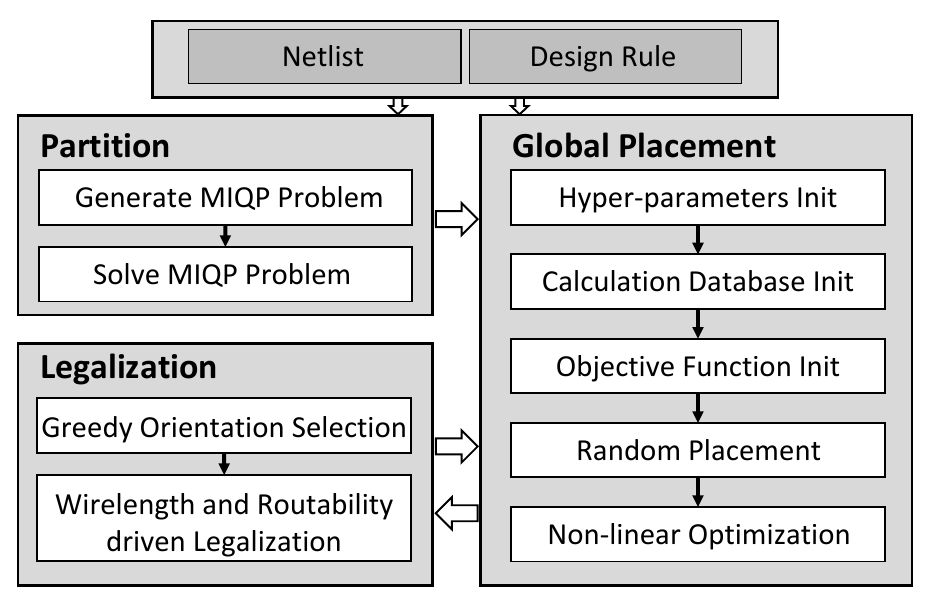

# ULTRA-2.5D

**An Analytical Placement Framework for Ultra-Large-Scale Multi-Reticle Chiplet Systems**

ULTRA-2.5D is an analytical placement framework for ultra-large-scale, multi-reticle 2.5D chiplet systems. Through partitioning, differentiable global placement, and legalization, it jointly optimizes chiplet positions, rotations, and flips while considering cross-reticle connectivity and stitching constraints.

## Method Overview

- **Multi-reticle partitioning**: Uses MIQP to assign chiplets to reticles or stitching regions, considering connectivity, critical nets, and area utilization.
- **Differentiable global placement**: Uses Gumbel-softmax to relax discrete orientations and jointly optimize positions, rotations, and flips, with GPU acceleration support.
- **Constraint-aware legalization**: Combines discrete orientation selection, constraint graphs, and linear programming to eliminate overlaps and satisfy boundary constraints; includes routability evaluation and optimization modules.

<p align="center">
  
</p>

*Overall flow, reproduced from Fig. 6 of the paper.*

Experimental figures, tables, and data are collected in [Experimental Results](docs/result/result.md).

## Directory Structure

```text
ULTRA-2.5D/
├── main.py                       # Python partitioning and placement flow
├── src/
│   ├── cu_placer/                # C++/CUDA placement, legalization, and routability modules
│   └── milp_solver/              # CPLEX solver for the partitioning model
├── python/
│   ├── case_generator/           # Chiplet, pin, net, and interposer generation
│   ├── cluster_assignment/       # Pin-cluster assignment
│   ├── partition/                # MIQP partitioning
│   ├── placer/                   # Placement engine wrappers
│   └── utils/                    # Data I/O utilities
├── celldata/                     # Selected benchmarks, placement strategies, and partition results
├── scripts/
│   ├── reticle_type/             # Reticle geometry and adjacency matrix generation
│   ├── regular_chiplet_gen/      # Regular chiplet benchmark description generation
│   ├── routability_viewer/       # Routability visualization tools
│   └── dynamic_viewer.html       # Placement process viewer
└── docs/
    └── result/
        ├── result.md             # Experimental figures, tables, and data
        └── image/                # Documentation images
```

*Note: Since the source files for the 225-chiplet and 1225-chiplet cases are large, `scripts/regular_chiplet_gen/tcg.py` is provided to generate their benchmark descriptions. Set `Nx_chiplet = Ny_chiplet = 15` for 225 chiplets or `35` for 1225 chiplets, and configure the geometry and output path for the selected case.*

## Building and Running

The following build and run commands target **Linux** and are executed from the project root.

### 1. Prepare Dependencies and Build

- CMake ≥ 3.13, a compiler supporting C++17, and the CUDA Toolkit.
- IBM ILOG CPLEX (with a valid license), Boost, JsonCpp, spdlog, Armadillo, BLAS/LAPACK/OpenBLAS, OptimLib, and its BaseMatrixOps headers.
- Python 3 and the dependencies required by the Python flow:

```bash
python -m pip install numpy scipy matplotlib pyomo
```

First, replace `/path/to/...` in `src/cu_placer/CMakeLists.txt` with the actual installation paths, and adjust `CMAKE_CUDA_ARCHITECTURES` for your GPU (currently set to `80`). Ensure the configured library filenames match your installed versions.

```bash
cmake -S src/cu_placer -B src/cu_placer/build
cmake --build src/cu_placer/build -j
```

The generated executable is located at `src/cu_placer/bin/cu_placer`. In each benchmark's `strategy.json`, `en_gpu` controls whether the GPU is used at runtime; the current build configuration still depends on CUDA even when CPU execution is selected.

For MIQP partitioning, also build the CPLEX solver. Update the compiler paths, `CPLEX_ROOT_DIR`, and CPLEX library filename in `src/milp_solver/CMakeLists.txt` to match your installation before running:

```bash
cmake -S src/milp_solver -B src/milp_solver/build
cmake --build src/milp_solver/build -j
```

This produces `src/milp_solver/bin/milp_solver`. The solver reads `hur_partition/milp_model.lp` and writes `hur_partition/chiplet_allocation.txt` under the selected benchmark directory. It is only needed when recomputing an MIQP partition; placement with existing partition results can use `cu_placer` directly.

### 2. Run Placement Using Existing Partition Results

The `celldata/atplace_case/case_36c/` directory already contains placement inputs, `strategy.json`, and partition results. After building `cu_placer`, run:

```bash
./src/cu_placer/bin/cu_placer "$PWD/" "celldata/atplace_case/case_36c/"
```

The two arguments are the project root directory and the relative benchmark directory, respectively. **Both must retain the trailing `/`.** The input files are:

| File (relative to the benchmark directory) | Contents | Source / Generation Method |
| --- | --- | --- |
| `json_chiplets/chiplet.json` | Chiplet, pin, and net information | Generated by `Chiplets.generate()` in `python/case_generator/generator.py`; `ClusterAssignment.assign_chiplet_cluster()` in `python/cluster_assignment/cluster_assignment.py` then updates pin-cluster assignments and net connectivity. |
| `json_chiplets/interposer.json` | Interposer information | Generated by `python/case_generator/generator.py` from the `interposer` field in the benchmark description. |
| `place_init/case_discription.json` | Benchmark description and connectivity matrices; the filename retains the spelling used in the code | Copied from the benchmark-root `case_discription.json` by `MainFlow.generate_case()` in `main.py`, preserving the supplied chiplet locations and connectivity. |
| `hur_partition/reticle_msg.txt` | `[x, y, w, h]` for each reticle | Exported by `Partition` in `python/partition/partition.py` from the `Gr` array in the selected reticle `.npz`; generate the `.npz` with `scripts/reticle_type/gen_reticle.py`. |
| `hur_partition/chiplet_allocation.txt` | Chiplet partition assignments; `0` denotes the stitching region and `1..Nr` denote reticles | Written by `src/milp_solver/bin/milp_solver` after `Partition.run_MIQP()` in `python/partition/partition.py` exports the model. |
| `strategy.json` | GPU switch, spacing, optimization stages, and parameter scheduling | A user-configured benchmark file; see `celldata/atplace_case/case_36c/strategy.json`. The placer reads it in `src/cu_placer/flow.h`. |

The final placement is written to `placer/chiplet_pla.json` under the benchmark directory. Execution logs and snapshots are also stored under `placer/`. Repeated runs update this result file.

### 3. Run Partitioning and Placement Through Python

The active flow in `main.py` runs partitioning followed by analytical placement using prepared benchmark inputs.

1. Set `work_path` in `main.py` to the absolute project root, including the trailing `/`.
2. Configure `Cr` (reticle adjacency) and `Gr` (reticle geometry) in `scripts/reticle_type/gen_reticle.py` for your cases, then run:

   ```bash
   python scripts/reticle_type/gen_reticle.py
   ```

3. Update `case_idx` in `main.py` to select prepared benchmark directories and the corresponding generated `.npz` filenames. The flow looks for these files under `scripts/reticle_type/`.
4. Set `path_exe` in `Partition.call_MIQP_solver()` in `python/partition/partition.py` to the absolute path of the compiled `src/milp_solver/bin/milp_solver`.
5. Set `path_exe` in `Placer.gd_placer()` in `python/placer/placer.py` to the absolute path of the compiled `src/cu_placer/bin/cu_placer`.
6. Use `flow.partition(enmilp=True, reticle_file=reticle)` for MIQP partitioning, followed by `flow.run_gplacer(option="gd")` for analytical placement.

Then run:

```bash
python main.py
```

Repartitioning updates `hur_partition/reticle_msg.txt` and `hur_partition/chiplet_allocation.txt` before placement.

### 4. Prepare Custom Benchmark Inputs

For a new benchmark, prepare its root-level `case_discription.json`, then use `MainFlow.generate_case()` to copy the description into `place_init/`, generate the chiplet and interposer JSON files, and assign pin clusters. The supplied chiplet locations are preserved.

Run the following from the project root, replacing `case_dir` with your benchmark directory:

```bash
python - <<'PY'
from pathlib import Path
from main import MainFlow

work_dir = str(Path.cwd()) + "/"
case_dir = "celldata/my_case/"
(Path(work_dir) / case_dir / "place_init").mkdir(parents=True, exist_ok=True)

flow = MainFlow(work_dir, case_dir)
flow.generate_case()
PY
```

The generation flow calls these modules in order:

1. `python/case_generator/generator.py`: `Chiplets.generate()` creates `json_chiplets/chiplet.json` and `json_chiplets/interposer.json` from `place_init/case_discription.json`.
2. `python/cluster_assignment/cluster_assignment.py`: `ClusterAssignment.assign_chiplet_cluster()` assigns pin clusters and updates net connectivity in the generated chiplet JSON.

For regular-grid cases, `scripts/regular_chiplet_gen/tcg.py` can generate the benchmark description first. Configure its grid dimensions, interposer dimensions, pin counts, and output path, and save the result as the benchmark-root `case_discription.json`.

Use an absolute `work_dir` and a project-relative `case_dir`, both with a trailing `/`. Configure a benchmark-specific `strategy.json` and matching reticle geometry before partitioning and placement. The default loop in `main.py` uses prepared inputs; call `flow.generate_case()` before `flow.partition(...)` when generating a new case.
